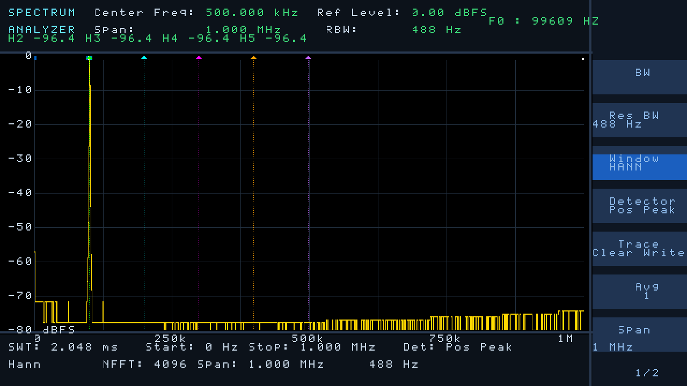
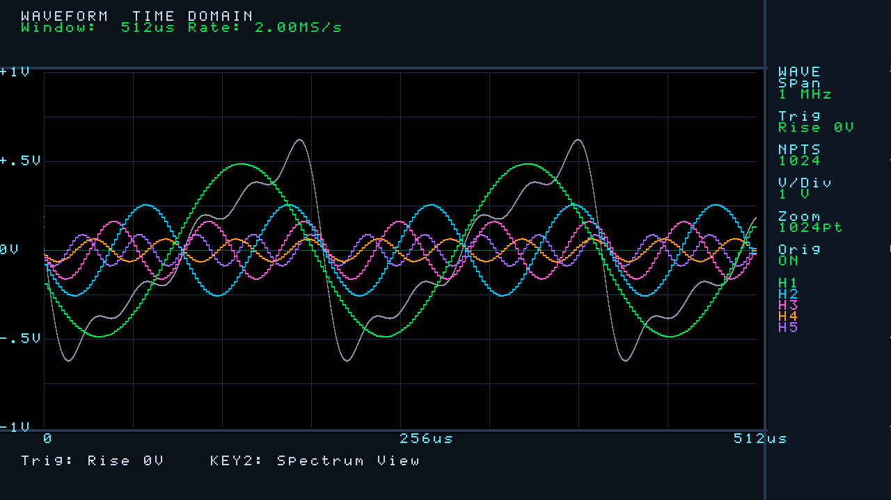

# AD9226 + HDMI 数字频谱分析仪（Tang Nano 20K / GW2AR-18）

[](LICENSE)
[](https://github.com/Youlai114/AD9226-Spectrum-Analyzer/releases)
[](#)

用一片 **高云 Tang Nano 20K**（GW2AR-18C）直采 **AD9226 12bit / 54 MSPS** ADC，
在片上做 **4096 点 FFT**，把频谱、瀑布图和时域波形直接送到 **HDMI 显示器**。
没有 MCU、没有上位机软件 —— 上电即出图。



> 上图是 RTL **仿真渲染**的真实输出（AD9226 行为模型 → 抽取 → 加窗 → 4096 点 FFT
> → 逆 sinc 补偿 → 显示整条链路），不是示意图，也不是贴图。

---

## 1. 指标一览

| 项目 | 参数 |
|---|---|
| ADC | AD9226，12 bit，54 MSPS 固定采样（板载 27 MHz 晶振经 PLL ×2） |
| FFT | 4096 点基 2 DIF 定点，逐级 ÷2 定标 |
| 窗函数 | Hann / Rect / Blackman / FlatTop，相干增益已校准 |
| 频率跨度 | 1 MHz / 250 kHz / 50 kHz / 10 kHz / **27 MHz（宽频直采）** |
| 抽取比 | 27 / 108 / 540 / 2700 / 1 |
| RBW | 7.3 Hz（Span 10 kHz，Hann）～ 19.8 kHz（宽频） |
| 幅度 | 满量程 0 dBFS，逆 sinc 补偿后通带平坦度 ±0.02 dB |
| 刷新 | 档 0 约 150 fps；Span 10 kHz 约 4.8 fps（16 帧视频平均，慢档 4 帧） |
| 视图 | 频谱 + 瀑布 + 菜单 / 纯净频谱 / 时域波形（含 1~5 次谐波分量） |
| 人机 | 5 个按键 + EC11 旋转编码器（短按 / 长按区分） |
| 资源 | LUT 8924（7544 LUT + 1380 ALU）、Register 3019 / 15750 = 20%、BSRAM 37 / 46 = 81% |
| 时序 | setup/hold 违例 **0**（三时钟 TNS 全 0）；tmds 域 Fmax 74.33 / 74.25 MHz（余量 0.1%） |
| 验证 | 一键回归 9 步 8 项全通过；RTL 与比特精确模型逐点 0 LSB 偏差 |

**为什么 ADC 不降到 2 MHz 采样**：AD9226 是流水线 ADC，低时钟会逼近内部采样保持的
droop 边界，且时钟抖动直接变成采样误差。让 ADC 恒跑 54 MSPS，在数字域做 27 点平均
抽取，顺带白赚 `10·log₁₀(27) ≈ 14.3 dB` 噪声处理增益。

**为什么抽取比是 27 而不是 32**：54 / 27 = 2.000 MHz，跨度正好 1.000 MHz；取 32 则
跨度 843.75 kHz，屏幕上刻度全是小数。

### 1.1 时域谐波分解（v1.2.0 新增，v1.2.1 修文字与时基）

KEY2 切到时域视图后，屏幕除了灰色原始采样波形，还会同时画出 **1~5 次谐波各自的分量
正弦**（绿/青/品红/橙/紫，与频谱视图的谐波标记同色）：



一路采样里各次谐波本来就是叠加在一起的，直接在时域"分离"是不可能的——所以这里走
FFT 的复数 bin：基波谐波检测给出 5 个 bin 的 (re, im)，用幅度与相位重建每条分量
`A·cos(2πft + φ)` 再画出来（各分量之和 ≈ 灰线，可以互相印证）。

| 操作 | 作用 |
|---|---|
| 编码器旋转 | 时基档：显示记录的前 **1024 / 512 / 256 / 128** 点（默认 256 点，低频用 1024 点看整段） |
| 编码器短按 | 幅度档：满屏 **±2V / ±1V / ±0.5V / ±0.25V / ±0.125V / ±0.0625V** |
| KEY4 | 原始波形（灰线）开 / 关 |
| KEY1 / KEY5 | 仍分别切跨度与窗函数（换跨度会改变采样率，也就是时间刻度） |

---

## 2. 目录结构

| 路径 | 内容 |
|---|---|
| `ad9226_hdmi_spectrum/` | **当前主工程**：`src/` RTL、`sim/` 仿真、`tools/` 工具脚本、`build.tcl`、`impl/` 综合布线产物、`doc/` 引脚与板级文档 |
| `ad9226_hdmi_spectrum/README.md` | 主工程详解（引脚表、逐模块说明、实测数据） |
| `ad9226_hdmi_spectrum/CODE_GUIDE.md` | 代码阅读引导（数据流走查、坑位清单） |
| `hdmi_spectrum/` | 早期 HDMI 显示工程（频谱显示部分的上游来源，保留参考） |
| `AD9226_FPGA_V1.1_65M/` | 原始 Altera Cyclone IV 示例工程（AD9226 采样部分的上游来源） |
| `ad9226_tangnano20k/` | 首次移植尝试（历史归档） |
| `文档/` | 交接文档、操作手册、代码阅读引导、程序对照注释手册、上板测试记录表（.docx）及其生成脚本 |
| `release/` | 打好的发布包 zip |

---

## 3. 快速开始

### 3.1 出比特流

```bash
# 方式一：Gowin IDE 打开工程
ad9226_hdmi_spectrum/ad9226_hdmi_spectrum.gprj

# 方式二：命令行（Gowin V1.9.11 Education 及以上）
cd ad9226_hdmi_spectrum
"D:/Gowin/Gowin_V1.9.11.03_Education_x64/IDE/bin/gw_sh.exe" build.tcl
```

产物：`ad9226_hdmi_spectrum/impl/pnr/ad9226_hdmi_spectrum.fs`（约 7.0 MB）。
烧录用 Gowin Programmer，或开源工具 `openFPGALoader -b tangnano20k <file>.fs`。

`build.tcl` 里开了时序驱动布局布线（`-place_option 2 / -route_option 2`）：
不加时 tmds 域最差 setup 只剩 +0.007 ns，加上后 +0.757 ns。**tmds 是最紧的域**，
往像素域加逻辑后请先跑一次综合看 Fmax。

### 3.2 跑回归

需要 ModelSim 10.1a（`vlog/vsim/vlib`）与 Python 3（带 numpy）。脚本里的解释器
与仿真器路径是写死的，换机器要先改 `ad9226_hdmi_spectrum/tools/run_regression.sh`
顶部的 `VLOG/VLIB/VSIM/PY` 四个变量。

```bash
cd ad9226_hdmi_spectrum
bash tools/run_regression.sh
```

8 步 7 项：FFT 比特精确比对（0 LSB）、四窗相干增益校准、基波列检测、
编码器 13 项、时域迹线、顶层渲染六要素、光标跳峰 + Δ 模式透传。

### 3.3 引脚

AD9226 的 14 根线全部走两侧 2×10 排针，避开所有复用脚（SPI Flash、WS2812、
功放使能、HDMI EDID、54/55/56 专用脚）。完整对照见
[`ad9226_hdmi_spectrum/doc/引脚对照与约束.md`](ad9226_hdmi_spectrum/doc/引脚对照与约束.md)。

---

## 4. 文档

| 文档 | 说明 |
|---|---|
| [主工程 README](ad9226_hdmi_spectrum/README.md) | 指标、引脚、逐模块原理、实测数据 |
| [代码阅读引导](ad9226_hdmi_spectrum/CODE_GUIDE.md) | 按数据流顺序读代码，含坑位清单 |
| `文档/交接文档.docx` | 项目交接：现状、遗留、版本管理、发布流程 |
| `文档/操作手册.docx` | 按键 / 编码器操作与屏幕元素说明 |
| `文档/程序对照注释手册.docx` | RTL 逐段注释对照 |
| `文档/上板测试记录表.docx` | 上板实测记录与待复测项 |
| [CHANGELOG.md](CHANGELOG.md) | 版本变更记录 |

`.docx` 都由 `文档/gen_*.py` 生成，改内容请改脚本后重跑（需 `python-docx`）。

---

## 5. 版本与发布

- [v1.2.1](https://github.com/Youlai114/AD9226-Spectrum-Analyzer/releases/tag/v1.2.1) —
  时域视图上板反馈修复：27 处文字长度错位、字符发虚、左边缘竖线；时基改为
  1024/512/256/128 点（原来越缩越窄，低频看不到一个周期）；幅度档扩到 6 档
  （±2V…±0.0625V）；像素域组合链拆两级流水，时序拉回 TNS 全 0
- [v1.2.0](https://github.com/Youlai114/AD9226-Spectrum-Analyzer/releases/tag/v1.2.0) —
  时域视图新增 **1~5 次谐波分量同时显示**（FFT 复数 bin 重建），幅度四档 / 时基四档可调；
  比特流重出，TNS 全 0
- [v1.1.1](https://github.com/Youlai114/AD9226-Spectrum-Analyzer/releases/tag/v1.1.1) —
  仓库清理版：全部历史提交去除非公开材料引用，三个版本发布包重打（RTL 与比特流同 v1.1.0）
- [v1.1.0](https://github.com/Youlai114/AD9226-Spectrum-Analyzer/releases/tag/v1.1.0) —
  上板反馈修复 + 逐文件代码通读复查修掉 12 处静默缺陷，比特流重出（TNS 全 0）
- [v1.0.0](https://github.com/Youlai114/AD9226-Spectrum-Analyzer/releases/tag/v1.0.0) — 首个基线版本

每个 Release 附 `spectrum_vX.Y.Z_日期.zip` 发布包（固件 + 文档 + 工具）。

---

## 6. 当前状态与已知限制

- v1.2.0 比特流已重出、时序收敛（TNS 全 0，像素域余量仅 0.1%）；**以下五项只做过
  仿真与综合，尚待上板复测**：
  0. 时域视图 5 条谐波是否与灰线原始波形对齐、编码器调时基/幅度是否顺滑
  1. 底栏 `Win:` / `RBW:` 两个标签是否都在（此前 `Win:` 被顶出屏外）
  2. KEY1 第 5 档能否真正进 27 MHz 宽频（此前档位被 2bit 截断）
  3. KEY4 第二下是否出现 ΔF / ΔdB 读数（增量 Δ 模式）
  4. 基波列号较大时 H2~H5 谐波电平表是否仍对齐（此前 10bit 窗口列会回绕）
- 其余已知限制（位宽截断告警、敏感表告警等）见主工程 README「已知限制」与
  `CODE_GUIDE.md` 7.1~7.3。

---

## 7. 许可证

代码、比特流、工具脚本与技术文档以 **MIT License** 发布，详见 [LICENSE](LICENSE)。

