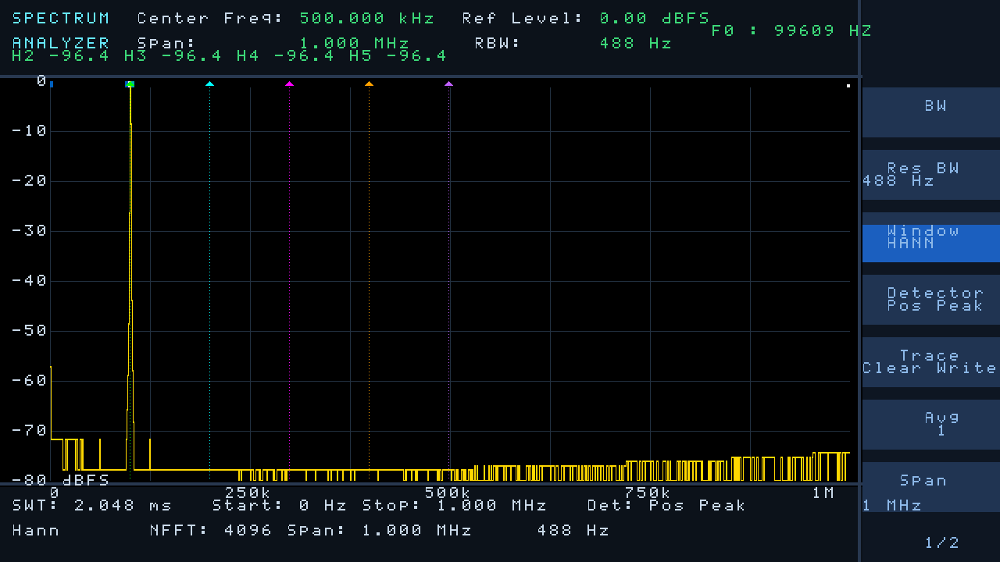
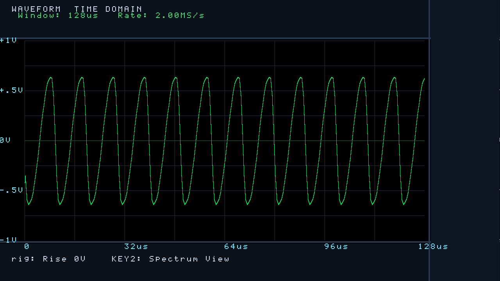
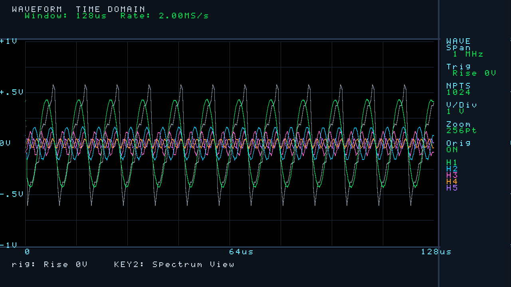
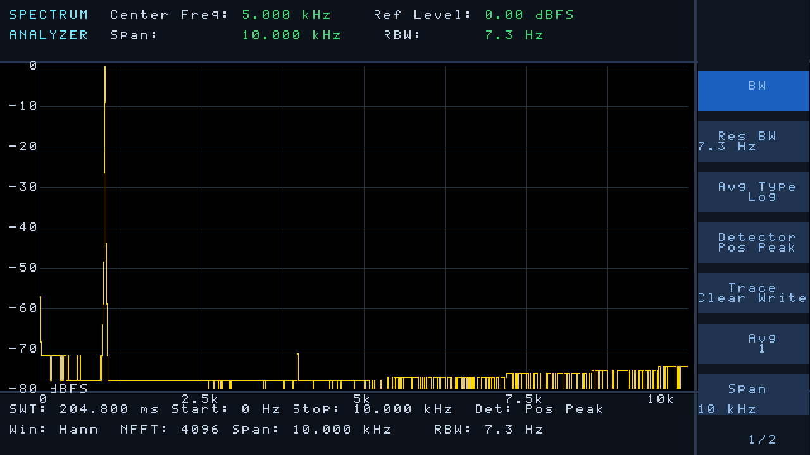

# AD9226 + HDMI 频谱分析仪（Tang Nano 20K / GW2AR-18）

把原来跑在 Altera Cyclone IV（EP4CE15）上的 **AD9226 12bit 采样例程** 改写，
合入已经跑通的 **HDMI 频谱显示工程**，整体适配到高云 **Tang Nano 20K**。
测量目标是 **0 ~ 1 MHz 的低频信号**，采用 **4096 点 FFT**。

**KEY2 可在两种视图间切换（2026-10-24 新增）：**

| 频谱视图：100kHz 单音 + 1~5 次谐波标记 | 时域视图：100kHz 失真正弦（边沿触发） |
|---|---|
|  |  |

- **频谱视图**：FFT 幅度谱；自动检测基波峰值列，在 k×f0（k=1..5）处画
  5 色三角+虚线谐波标记（绿/青/品红/橙/紫）。基波 ≥ -12 dBFS 才显示。
- **时域视图**：wave_cap 电平边沿触发采 1024 点，按时间基显示其中 1024/512/256/128 点
  （默认 256 点；1024 点时 Span 1MHz 档窗口 512us，5kHz 也能看到完整周期），每样点
  最多 4 列线性内插。迹线逐列与期望内插值 **0 偏差**（tb_wave_frame 自检）。
- **时域谐波分解（v1.2.0 新增，v1.2.1 修时基与文字，v1.2.2 放宽基波门限）**：同一屏再叠加 1~5 次谐波各自的
  分量正弦（`harm_est.v` 用 FFT 复数 bin 的幅度+相位重建），灰色为原始采样波形
  （KEY4 可关）；编码器旋转切时基（**1024/512/256/128 点**），编码器短按切幅度档
  （**±2/±1/±0.5/±0.25/±0.125/±0.0625 V** 六档）。
  

上板后 HDMI 直接显示 **AD9226 实测的频谱**（不是贴图、不是演示数据）：


> 上两图都是 RTL **仿真渲染**的真实输出（AD9226 行为模型 → 抽取 → Hann 窗 → 4096 点 FFT
> → 逆 sinc 补偿 → 显示整条链路），不是示意图。

| Span 1 MHz（全带概览，250 kHz 单音） | Span 10 kHz（音频段，1 kHz 单音） |
|---|---|
|  |  |

左边：250 kHz 落在 1/4 处，RBW 732 Hz；右边：1 kHz 落在 1/10 处，RBW 7.3 Hz。
两边的 Center/Span/RBW/SWT 都是程序按真实链路算出来的，不是写死的字。

---

## 1. 一句话结论

| 项目 | 结果 |
|---|---|
| ADC 采样率 | **54 MSPS 固定**（板载 27 MHz 晶振，PLL ×2） |
| FFT 采样率 | **2 M / 500 k / 100 k / 20 k**（数字抽取 27 / 108 / 540 / 2700） |
| FFT | **4096 点**、Hann 窗、16bit 定标、逐级除 2 |
| 频率跨度 | **1 MHz / 250 kHz / 50 kHz / 10 kHz / 27 MHz(宽频)**（Span = fs/2） |
| 宽频模式 | fs = 54 MSPS 直采无抽取，Span 27 MHz **覆盖 0~10 MHz**，RBW 19.8 kHz，SWT 75.9 µs |
| 分辨率 | bin 4.88 Hz ~ 13.2 kHz，Hann **RBW 7.3 Hz ~ 19.8 kHz** |
| 幅度 | 满量程 = 0 dBFS；**通带平坦度 ±0.02 dB**（已做逆 sinc 补偿） |
| 视频平均 | 16 帧指数平均（Span 10k 慢档自动改 4 帧），噪底平滑、读数稳定 |
| 刷新 | 一屏算一帧（档 0 约 150 fps，档 3「Span 10 kHz」约 4.8 fps） |
| 资源 | LUT 8924（7544 LUT + 1380 ALU）/20736、Register 3019/15750、**BSRAM 37/46 (81%)** |
| 时序 | setup/hold 违例端点 **0**（最差 setup +0.015 ns，慢角；tmds 74.33/74.25、adc 54.08/54.00） |
| 验证 | RTL 与比特精确模型**逐点 0 LSB 偏差**；综合+布线+比特流跑通；回归 9 步 8 项全过 |

**为什么 ADC 时钟不降到 2 MHz**：AD9226 是流水线 ADC，时钟越低越接近内部
采样保持的 droop 边界，且低时钟的抖动会直接变成采样误差。让 ADC 一直跑 54 MSPS、
在数字域做 27 点平均抽取，还白赚 **10·log₁₀(27) ≈ 14.3 dB** 的噪声处理增益。

**为什么抽取比是 27 而不是 32**：54/32 = 1.6875 MHz，跨度 843.75 kHz，
屏幕上频率刻度会变成一串小数；27 抽 1 正好 **2.000 MHz**，跨度 1.000 MHz。

---

## 2. 引脚对照（详见 `doc/引脚对照与约束.md`）

AD9226 的 14 根线全部接两侧 2×10 排针，**避开了所有有复用功能的脚**
（SPI Flash、WS2812、功放使能、HDMI EDID、以及 54/55/56 这三个 SSPI 专用脚）。

| AD9226 信号 | Nano 20K 管脚 | 排针位置 |
|---|---|---|
| CLK（54 MHz 输入） | **76** | J6-3（紧邻 GND） |
| OTR（过压标志） | **42** | J6-5 |
| D11 | **41** | J6-6 |
| D0 | **73** | J5-1 |
| D1 | **74** | J5-2 |
| D2 | **75** | J5-3 |
| D3 | **77** | J5-5 |
| D4 | **27** | J5-8 |
| D5 | **28** | J5-9 |
| D6 | **25** | J5-10 |
| D7 | **26** | J5-11 |
| D8 | **29** | J5-12 |
| D9 | **30** | J5-13 |
| D10 | **31** | J5-14 |
| 5V | J6-1 | 模块 5V（建议外部供电，共地） |
| GND | J6-2 / J6-15 / J5-20 | 至少接 2 根 |

---

## 3. 目录

```
ad9226_hdmi_spectrum/
  ad9226_hdmi_spectrum.gprj   高云工程（双击打开即可综合）
  build.tcl                   命令行全流程：gw_sh build.tcl
  src/
    video_top.v               顶层：3 个时钟域 + 数据源选择 + 显示 + TMDS
    ad9226_pll.v              27MHz -> 54MHz rPLL
    ad9226_capture.v          ADC 采样 + 抽取 27/108/540/2700 + 去直流
    fft4096.v                 4096 点定点 FFT + 2 点 1 列 + 开方 + 补偿 + 基波峰值检测
    fft_tables.v              Hann 窗 / 旋转因子 / 逆 sinc 补偿表（脚本生成）
    wave_cap.v                时域波形采集 (1024 点 + 电平边沿触发)
    wave_display.v            时域波形显示 (灰线原始 + 5 条谐波分量, 示波器风格)
    harm_est.v                谐波重建: 用 FFT 复数 bin 的幅度+相位合成 1~5 次分量正弦
    harm_ram.v                谐波行值乒乓 RAM (2 x 256 x 50bit, 5 lane)
    sincos_rom.v              1024x16 四分之一正弦表 + 象限译码 (脚本生成)
    key_enc_ctrl.v            5 键消抖 + EC11 正交解码 + 跨度管理
    ad9226_hdmi_spectrum.cst  引脚约束
    ad9226_spectrum.sdc       时钟/输入延时/跨时钟域约束
    （其余为原 HDMI 频谱显示工程：spec_display / spec_data_if / spec_ram /
      ui_text_rom / ui_font_rom / dvi_tx / TMDS_rPLL，未改动逻辑）
  tools/
    model_fft.py              FFT 比特精确模型 + 生成 fft_tables.v
    cmp_fft.py                仿真结果 vs 模型逐点比对
    check_flat.py             端到端通带平坦度检查
    gen_font.py               界面文字/字模生成（跨度为真实 1M/500k/250k）
    ppm2png.py                仿真截图转 PNG
    gen_pin_summary.py        从 .cst 解析生成引脚汇总 CSV
  sim/
    tb_fft.v                  采集+FFT 仿真，落盘样点与幅度
    tb_frame.v                把幅度灌进显示，渲染整帧 PPM/PNG
    out/ frames/              仿真产物
  doc/
    引脚对照与约束.md          引脚、电平、时钟、时序、接线、调试（重点看这个）
    引脚约束汇总.md            全部 34 个管脚的约束汇总（按功能 / 按排针两种视图）
    引脚约束汇总.csv           同上，表格版，可直接导 Excel 画封装
    打板说明.md                载板设计：电源、上拉、抗混叠焊盘、布局、上电顺序
    PCB布线规则.md             走线规则：层分工、线宽、电源链、CLK、铺地、发板自检
    TangNano20K_引脚图.jpg      官方 pinout，逐脚核对过
```

---

## 4. 怎么跑

**综合/烧录**

```
gw_sh build.tcl          # 或者用高云 IDE 打开 .gprj 点 Synthesize/Place&Route
# 产物: impl/pnr/ad9226_hdmi_spectrum.fs
```

> `build.tcl` 必须用 `open_project` 打开 `.gprj`。如果改成逐个 `add_file`，
> 高云不会读 `.sdc`，`create_clock`/`set_input_delay` 全部静默失效——
> 看起来"时序通过"，其实根本没约束。这个坑已经踩过，写在 tcl 注释里。

**仿真（ModelSim）**

```bash
vlib work
vlog ../src/ad9226_capture.v ../src/fft4096.v ../src/fft_tables.v tb_fft.v
vsim -c -do "run -all; quit -f" tb_fft +F0=250e3 +DEC=0   # +DEC=1/2 换档
python ../tools/cmp_fft.py                                # 与模型逐点比对
python ../tools/check_flat.py                             # 通带平坦度

vlog ../src/spec_display.v ../src/spec_data_if.v ../src/spec_ram.v \
     ../src/ui_font_rom.v ../src/ui_text_rom.v tb_frame.v
vsim -c -do "run -all; quit -f" tb_frame +HRM=102   # 渲染频谱+谐波标记 (+HRM=-1 关闭)

# 时域波形整链路 (ADC 谐波模型 -> 抽取 -> 触发 -> 渲染), 自检逐列 0 偏差
vlog ../src/wave_cap.v ../src/wave_display.v tb_wave_frame.v
vsim -c -do "run -all; quit -f" tb_wave_frame       # 输出 frames/wave_000.ppm

# 顶层联调 (三时钟域真实运转, 桩掉 rPLL/CLKDIV/DVI, 不用上板)
vlog ../src/gowin_rpll/TMDS_rPLL.v ../src/ad9226_pll.v ../src/video_top.v \
     ../src/video_timing.v ../src/key_enc_ctrl.v ../src/auto_span.v \
     ../src/spec_*.v ../src/ui_*.v ../src/ad9226_capture.v ../src/wave_*.v \
     ../src/fft*.v gw_stubs.v tb_top.v
vsim -c -do "run -all; quit -f" tb_top +DUMP1=4 +DUMP2=8
#   帧 4 = 频谱视图, ~95ms 处自动按 KEY2, 帧 8 = 波形视图
vsim -c -do "run -all; quit -f" tb_top +DUMP1=6 +DUMP2=8 +F0=20000 +AUTO
#   +AUTO: 60ms 自动按 KEY3, 断言 20kHz 信号切到 Span 250kHz;
#   帧 6 = AUTO 后频谱 (谐波标记 5/5 在 20k..100k), 帧 8 = 波形 (10 个周期)
```
```

**人机界面**（打板版本）：5 个按键 + EC11 旋转编码器，由 `key_enc_ctrl.v` 处理。
编码器旋转切跨度（到头停），按压 = Preset，KEY1 = 循环切跨度，
**KEY2 = 频谱/时域视图切换**，**KEY3 = AUTO 自动跨度**，**KEY4 = 光标三态（关/普通/增量 Δ）**，
KEY5 = Preset。按键/编码器都没有外加 RC 也能用，但打板时建议加上（见 `doc/打板说明.md`）。

**光标（KEY4 三态：关 → 普通读数 → 增量 Δ）**：普通态在频谱上放白虚线光标
（顶部实心小竖条 + 隔行虚线）。光标开启时**编码器改为移动光标**（每格 ±4 列，到边停），
关闭时恢复调跨度；
波形视图下光标自动隐藏、编码器自动回到调跨度。光标开启时**编码器按压 = 光标
跳到基波峰值**（关闭时按压仍是 Preset）。
顶栏右侧实时显示光标位置的频率和幅度：`MKR 250000 HZ -12.3 DB`
（频率 = 列/1024 × Span，Hz 整数，前导零消隐；宽频档自动改用 kHz、单位显示
KHZ；幅度取该列迹线值，0.1dB 分辨率，幅度为 0 时显示下限 -96.4）。读数由
每帧一个小 double-dabble FSM 转成 BCD 后按位渲染，不占额外 RAM。

**谐波电平表（自动）**：基波检测有效时，顶栏第 4 行左侧自动显示 2~5 次谐波的
dBFS 电平：`H2 -12.2  H3 -18.2  H4 -24.2  H5 -28.3`（0.1dB 精度，绿字）。仪器在
k×基波列 ±2 列窗口内自动搜索各次谐波峰——接上信号即可直接抄数，不用移光标。
仿真端到端验证：ADC 谐波模型 1300/320/160/80/50，表读数与理论值
(20·lg(Ak/A1)=-12.2/-18.2/-24.2/-28.3 dB) 逐位一致。

**增量模式（谐波测量标准流程）**：光标跳到基波峰（编码器按压）后按 KEY4 进入
Δ 态——进入瞬间自动快照参考（暗青色虚线标出参考位置）；转编码器把光标移到
2~5 次谐波，读数变为 `DLT +99609 HZ -31.2 DB`：**ΔF 应等于基波频率，ΔdB 即
该次谐波相对基波的电平**。再按 KEY4 关闭。仿真验证 `+CSR=358 +CMODE=2`：
ΔF=99609Hz（102 列 × 976.5625）精确命中，参考线/双符号渲染正确。

仿真验证：`tb_frame.v` 加 `+CSR=256` 渲染，光标虚线落在第 256 列、
读数逐字符核对正确（`+CSR=51` 可验证频率前导零消隐；扫 2 帧可看到 dB
跟随上一帧抓幅更新）。

**完整键位表**（打板底板，引脚见 `doc/打板说明.md`）：

| 输入 | 功能 |
|---|---|
| KEY1 (15) | 循环切跨度：1M → 250k → 50k → 10k → 27M(宽频) → 1M |
| KEY2 (16) | 显示模式循环：**频谱+瀑布+菜单** → **纯净频谱**(菜单折叠) → **时域波形** → 回 |
| KEY3 (17) | AUTO 自动跨度（按基波位置选最窄能容纳 5 次谐波的档） |
| KEY4 (18) | **光标三态**：关 → 普通读数 → **增量 Δ**（DLT 读数 + 参考虚线）→ 关；**时域视图下改为原始波形开/关** |
| KEY5 (19) | **窗函数循环**：Hann(默认) → Rect → Blackman → FlatTop → Hann |
| 编码器旋转 (48/49) | 光标关: 调跨度（到头停）；光标开: 移光标 ±4 列/格；**时域视图下: 切时基 256/128/64/32 点** |
| 编码器按压 (72) | 光标关: **Preset**（回 Span 1MHz）；光标开: 光标跳到基波峰值；**时域视图下: 切幅度档 ±2/±1/±0.5/±0.25 V** |

**窗函数**（KEY5 循环，菜单 Window 按钮高亮显示当前窗）：同一信号四种窗读数一致
（相干增益已校准，±0.07dB），RBW 三处显示随窗联动：

| 窗 | ENBW 因子 | 旁瓣 | 适用 |
|---|---|---|---|
| Hann（默认） | 1.5 | -31.5 dB | 通用测量 |
| Rect（矩形） | 1.0 | -13 dB | 幅度最准（对准谱线时）、瞬态脉冲 |
| Blackman | 1.73 | -58 dB | 大小信号同屏（动态范围优先） |
| Flat Top | 3.77 | -93 dB | 幅度精度优先（±0.01dB，主瓣最宽） |

**瀑布图**（显示模式 0）：绘图区背景即瀑布——每帧频谱 4:1 峰值降采样成 256 列，
写进 128 行环形历史（新行在顶，每行 4px），8 级热色按幅度 dB 段直接映射
（0dB 白 → -70dB 以下黑）。黄色迹线、峰值保持、谐波标记、光标全部叠加其上，
信号随时间的漂移和间歇一目了然。RAM 98kbit（6 块 BSRAM），由 twiddle ROM
压缩腾出（sin 按 cos 的偶函数关系从单表读出，与原双表逐位等价，FFT 保持 0 LSB）。
**纯净频谱**（显示模式 1）：右侧菜单整体折叠成黑、瀑布关闭，画面最干净，
顶栏光标读数保留。

**BSRAM 优化记录**：文字网格 ROM（28 块 pROM）已替换为 spec_display 内的运行时
字符解码（put 任务按 cell_row 分组 case 化，渲染与旧版逐像素 diff=0），加上 twiddle
压缩（-2 块）与瀑布图（+6 块），BSRAM 从 98% 降到 **66%**，余 16 块供后续功能。
代价：Logic +6%（解码用 LUT）、文字解码路径较深（慢角 +0.08ns 仍收敛）。

**AUTO（KEY3）自动跨度**：按一下，仪器用当前帧的基波峰值检测结果
（f0 = 基波列/1024 × 当前跨度），自动挑选能容纳 **基波 + 5 次谐波**
（5·f0 ≤ 0.92·Span）的最窄跨度档；峰 < −12 dBFS（没找到有效信号）时
回退 1 MHz 全带概览。结果写回跨度管理，之后 KEY1/编码器/Preset 照常工作。
例：20 kHz 信号 → 自动切到 Span 250 kHz（5 次谐波 100 kHz 占 40% 屏宽）；
100 kHz 信号 → 保持 Span 1 MHz（5 次谐波 500 kHz 需要全带）。

仿真验证：`vsim -c -do "run -all; quit -f" tb_key_enc` —— 9 项检查（消抖、方向、
边界、Preset）全过（2026-10-24 复测确认）。

**不看板子也能确认界面**：`video_top.v` 里 `localparam USE_ADC = 0` 就切回
内置测试数据，其余逻辑不变。

---

## 5. 实测/仿真数据

### 5.1 定点链路 vs 模型（逐点 0 LSB）

| 用例 | 峰值列 | 读数 | RTL vs 模型 |
|---|---|---|---|
| 250 kHz，fs=2 M（抽 27） | 256 | 65260（-0.04 dBFS） | 0 LSB |
| 250 kHz，fs=1 M（抽 54） | 512 | 65253（-0.04 dBFS） | 0 LSB |
| 100 kHz，fs=500 k（抽 108） | 409 | 63571（-0.26 dBFS） | 0 LSB |
| 990 kHz，fs=2 M（落在 bin 之间） | 1014 | 56105（-1.35 dBFS） | 0 LSB |

最后一行是 **栅栏损失**（信号落在两个 bin 中间，Hann 窗固有 -1.42 dB），
不是补偿没做对；补偿只针对抽取滤波器的通带倾斜。

### 5.2 端到端通带平坦度（`tools/check_flat.py`）

```
频率         列     读数     误差 dB
0.5 kHz      0     65504    -0.00
24.9 kHz    25     65464    -0.01
100.1 kHz  102     65470    -0.01
250.0 kHz  256     65490    -0.01
500.0 kHz  512     65457    -0.01
750.0 kHz  768     65504    -0.00
899.9 kHz  921     65467    -0.01
989.7 kHz 1013     65442    -0.01
999.5 kHz 1023     65419    -0.02
```

补偿前，同样的 27 点抽取在带边（≈1 MHz）只有 **-3.8 dB**；
补偿用 1024 项逆 sinc 表（Q7，1.000~1.570 倍），三档共用一张表
（M=27 与 M=108 在同一归一化频率上差 < 0.01 dB）。

---

## 6. 已知限制（别当成 bug）

1. **没有模拟抗混叠滤波器**。窄跨度是"数字抽取"实现的，带外强信号会折叠进来。
   真实频谱仪靠前端低通解决，这里只能靠信号源本身干净。
2. **栅栏损失 ≤ 1.42 dB**：信号正好落在两个 bin 之间时读数会低一点，
   这是 Hann 窗的固有性质（想要更平可以换 flat-top 窗，代价是 RBW 变宽）。
3. **带边噪声抬高**：逆 sinc 补偿在 1 MHz 处把噪声也抬了 +3.9 dB，
   所以高端的噪声底看起来比低端高一点 —— 真实频谱仪同样如此。
4. **最低档（Span 250 kHz）刷新变慢**：4096 点 ×108 抽取要 8.2 ms 采集，
   单帧约 12.7 ms，仍在一屏（16.7 ms）之内，但没有多余余量。
5. **噪底可能落到显示范围以下**：27 点平均 + 4096 点 FFT 的处理增益很大，
   实际噪底约 -110 dBFS/bin，而纵轴只画到 -80 dB，所以小信号时底部看起来"很干净"，
   这是正常的（不是没数据）。想看到grass 可以把纵轴量程改成 0~-120。
6. 直流工作点假设 AD9226 模块输出以 2048 为中心。如果 0 Hz 处出现异常大峰，
   说明模块偏置不是 2 V，改 `ad9226_capture.v` 里的 `13'sd2048` 常数即可。
7. **时域视图的时基随跨度档变化**（窗口 = 256 点 / fs = 128us ~ 12.8ms）。
   看 100kHz 波形用 Span 1MHz 档（约 12.8 个周期）；窄跨度档对高于 fs/2 的
   信号会混叠出"变慢的假波形"，这是采样率的物理性质，不是 bug。
8. **谐波标记取"最大峰"为基波**：如果某次谐波比基波还强（罕见），标记会以
   最强的那根为基准；基波低于 -12 dBFS 门限时标记自动消失。
9. **AUTO 的边界**：基波频率 < 约 78 Hz（Span 10 kHz 档第 8 列以内，落在
   DC 排除区）时检测不到有效峰，AUTO 只会回退到全带概览；AUTO 只选跨度，
   不改纵向参考电平（纵轴固定 0 ~ -80 dBFS）。f0 在 184k~500k 之间时选
   Span 1MHz（5 次谐波可能超出右边界，需看全 5 次请手动进宽频档）；
   f0 > 500 kHz 自动进宽频档。换档后 1~2 帧内谱线还是旧档数据（过渡帧），
   期间谐波标记自动隐藏（测量档 ≠ 显示档不画），新帧到来即恢复。
10. **宽频档（Span 27 MHz）**：fs = 54 MSPS 直采，无抽取增益，噪底比窄档
   高约 14 dB（仍低于显示下限）；27~54 MHz 的带外信号会镜像折叠
   （前端无抗混叠滤波），测 0~10 MHz 时信号源需干净。
11. **换窗的过渡帧**：换窗瞬间窗形在采集开始时锁存（避免一帧内新旧窗混用），
   但文字/RBW 立即切换——随后的 1~2 帧内谱线仍是旧窗形状，增益与新窗匹配由
   锁存保证（不会出现读数错帧）。窗对瀑布图同样生效（历史行保留各自年代的窗）。
12. **视频平均与噪底阶梯**：无平均时噪底是 1~16 的小整数，对数显示下每跨一个
   整数跳 3~6dB，叠加逆 sinc 的平滑上斜就呈"从低频到高频的分段阶梯"。2026-10-25
   起幅度输出流加了 16 帧指数平均（4 位小数精度，首帧直通保证与模型 0 LSB），
   阶梯被平滑成缓变噪底；代价是信号突变的显示响应时间常数 ~16 帧
   （Span 1MHz 档约 0.1s，慢档自动改 4 帧）。**换跨度/换窗时平均自动重新预装**
   （参数指纹比较，与真实仪器"换参数即重启扫描"一致），不会出现旧谱拖尾。
13. **换档后瀑布历史混合**：瀑布是跨档连续的环形历史，换档后最长 128 帧内历史行
   仍含旧档频率（Span 10k 档约 27 秒），逐行滚出后纯净。真实仪器同样如此。
14. **H5 搜索窗边界**：基波恰在两 bin 正中时，5 次谐波列误差可达 ±2.5 列，超出
   ±2 列搜索窗，H5 读数可能偏低（H2~H4 误差 ≤1 列不受影响）；微调信号频率即可。
15. **Δ 参考快照时机**：跳峰后 ~17ms（一帧）内按 KEY4 进入增量，参考幅度可能取
   到旧列值并冻结；等一帧再进入即正确（或退出重进一次）。
16. **换档/换窗过渡帧**：标记/H 表/F0 已按跨度门控在过渡帧自动隐藏（与谱线新
   数据同时恢复），文字参数立即切换——1~2 帧内读数短暂消失是预期行为。
17. **时域谐波分量的精度与延迟**：分量正弦由 FFT 复数 bin 重建，估计窗取 512 点（≈ 1024 显示列的 1/2），谐波幅度低于约 -60 dBFS 时重建受噪声影响、看起来会抖，需要更长平均；重建本身约 0.6 ms 算完，但显示侧读的是上一帧的乒乓 bank，所以换跨度/换窗后 1~2 帧内谐波迹线仍是旧数据。
18. **时域纵横轴方向**：当前映射是 `row = 256 + (v >> 7)`（正电压 → 大行号）。若上板发现极性与 +1V 刻度相反，把 `harm_est.v` 与 `wave_display.v` 两处 `+` 改 `-` 即可（灰线与 5 条谐波在同一处，改完仍互相对齐）。


---

## 7. 文档索引与交接

| 文档 | 受众 | 内容 |
|---|---|---|
| 操作手册.docx | 使用者 | 接线/键位/读数/排障/窗函数/瀑布解读 |
| 代码阅读引导.docx + CODE_GUIDE.md | 接手开发者 | 数据流图/三条阅读路线/**已知边界与 BUG 清单** |
| 程序对照注释手册.docx | 接手开发者 | 逐模块实现细节与取舍 |
| 交接文档.docx | 交接双方 | 项目状态/环境/验证矩阵/待办/恢复手册/时间线 |

**接手者第一天读**: 交接文档.docx → 操作手册.docx → 代码阅读引导.docx。
**改代码前**: 代码阅读引导第 6 节 (★ 教训) + 第 7 节 (已知边界)。
**自检**: `bash tools/run_regression.sh` (9 步 8 项, 期望 ALL PASS)。

---

## 8. 与旧目录的关系

`../ad9226_tangnano20k/` 是更早的**只点 LED 的采集验证工程**，有两个问题已在新工程修正：

1. 它把板载晶振当成 **50 MHz**（实际是 **27 MHz**），PLL 参数 `FCLKIN="50"` 是错的；
2. 它的引脚里用了 **54/55/56**（I2S 那三个脚），这三个是高云 **SSPI 专用脚**，
   布线阶段会直接报 `cannot be placed`。

旧工程的 `.bit` 建议直接删掉，以 `ad9226_hdmi_spectrum/impl/pnr/*.fs` 为准。
