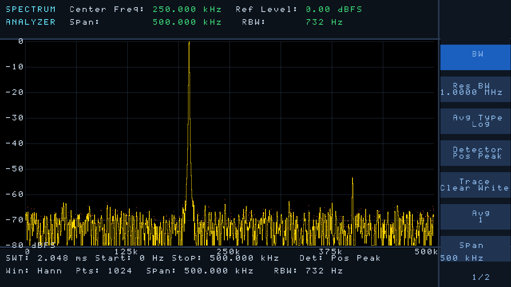
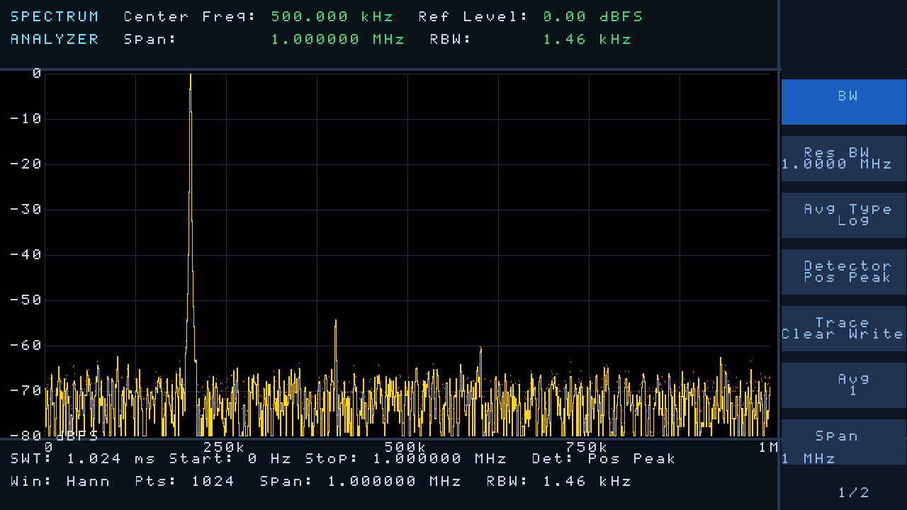
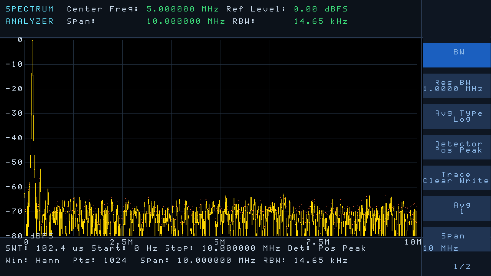

# hdmi_spectrum — 频谱分析仪 HDMI 显示

基于高云 GW2AR-18（Tang Nano 20K）官方 HDMI 例程改造的**频谱分析仪界面**。
保留原例程的时钟方案、DVI_TX IP、按键/LED 与引脚约束（可直接烧录），
界面仿台式频谱仪：顶部参数栏 + 黑底网格 + 黄色迹线 + 右侧菜单 + 底部状态栏。

默认上电显示 **200 kHz 单音正弦**的 FFT 幅度谱（fs = 2 MHz，2048 点 FFT，Hann 窗），
带谐波和噪声底，可以直接用来验证显示与数据通路。



| 跨度 0：500 kHz | 跨度 1：1 MHz | 跨度 2：10 MHz |
|---|---|---|
|  |  |  |

**动态演示**：`sim/out/spectrum_anim.html`（可切跨度、播放/暂停、单帧拖动），
或 `sim/out/spectrum_anim.gif`。

> 图片和动画都是 RTL **实际仿真**渲染出来的，不是示意图。

---

## 1. 界面

```
+--------------------------------------------------+-----------+
| SPECTRUM  Center Freq: 250.000 kHz   Ref: 0.00 dBFS |  [BW]   |  y 0..95
| ANALYZER  Span: 500.000 kHz        RBW: 732 Hz     | [Res BW] |
+--------------------------------------------------+           |
| 0 |                                              |  [Avg]    |  y 104..615
|-10|        /\         黄色迹线 + 黑底网格         | [Detector]|
|   |      /    \                                  |  [Trace]  |
|-80|                                              |  [Scale]  |
+--------------------------------------------------+-----------+
| Center Freq: 500.000 MHz  RBW: ...  VBW: ...  SWT: ...       |  y 624..719
+--------------------------------------------------------------+
```

* 分辨率 **1280×720@60Hz**，像素时钟 74.25MHz（与原例程一致）
* 绘图区 **x = 64…1087（1024 列）**，**y = 104…615（512 行）**
  * 横向：**0 … 1.0 MHz**（fs = 2 MSPS 的第一奈奎斯特区），1024 列 = 1024 个频点
  * 纵向：**对数刻度**，8 大格，每格 = 当前量程的 dB/div
* 按键切换纵向量程，LED[2:0] 进度条指示当前档位，LED[4] 心跳灯

* 绘图区正下方有**频率刻度**（每 2 大格一个标注，随跨度联动）
* 纵向刻度固定 10 dB/div（0 ~ -80 dB），8 大格
* **按键切换频率跨度**，每档用与其对应的真实 FFT 参数生成数据
  （fs = 2 × Span，2048 点 Hann 窗，200 kHz 输入不变）：

| 跨度 | fs | 每格 | RBW (ENBW) | SWT | 基波位置 |
|---|---|---|---|---|---|
| 0 | 1 MHz | 62.5 kHz | 732 Hz | 2.048 ms | 40% |
| 1 | 2 MHz | 125 kHz | 1.46 kHz | 1.024 ms | 20% |
| 2 | 20 MHz | 1.25 MHz | 14.65 kHz | 102.4 us | 2% |

顶栏/底栏的参数全部随跨度联动，且与实际链路对应（Span = fs/2、
RBW = Hann 窗 ENBW = 1.5 × fs/2048、SWT = 2048/fs、Ref = 0 dBFS、Pts = 1024）。

> 注意：跨度越大，同一个 200 kHz 信号在屏幕上占的比例越小（10 MHz 档只有 2%），
> 这是物理事实——真实频谱仪也是这样，所以要看细节就切小跨度。

**文字是怎么画出来的**：屏幕按 16×16 像素划成 **80×45 个字符单元**，
单元内容（字符 + 颜色 + 字号）存在 `ui_text_rom` 里（3 个量程层）。
渲染时只做 `(x,y) → 单元 → 字符 → 字模` 三级查表，**没有任何逐条文本的比较逻辑**。
改版面 = 改 `tools/gen_font.py` 里的 `put(col, row, "文字", 颜色)`，重新生成即可。

* 颜色码：0 白 / 1 绿 / 2 红 / 3 蓝
* `put_big()` 画 32px 大字（占 2×2 单元），**块起点必须落在 32px 网格上**（col/row 都为偶数）
* 字模 5×7 点阵，支持大小写字母、数字和 `.:/-+` 等少量符号

---

## 2. 测试数据：200 kHz 正弦

`spec_tone_gen`（在 `src/spec_demo_gen.v` 里）从 `tone_rom` 读出一帧幅度谱，
每帧突发写入 1024 个频点，并叠加 ±8 个码的随机噪声，让噪声底像真实 ADC 一样抖动。

数据由 `tools/gen_tone_rom.py` 用**真实 FFT** 算出（不是手工凑的曲线）：

```
采样率    2 MHz          FFT 2048 点 (周期 Hann 窗)
输入      200 kHz 正弦   -> 第 204.8 个 bin -> 屏幕 x = 205/1024 (20%)
谐波      HD2 -55 dBc, HD3 -62 dBc, HD4 -78 dBc, HD5 -82 dBc
噪声底    -72 dBFS/bin
幅度      16bit 线性, 65535 = 0 dBFS
```

实测：基波打到 0 dBFS（顶部），HD2 在 400 kHz 约 -57 dBFS，
HD3 在 600 kHz 约 -64 dBFS，HD4 已经埋进噪声底看不见——和真实 12bit ADC 的表现一致。

### 换频率 / 换采样率

```bash
python tools/gen_tone_rom.py --f0 200e3 --fs 2e6 --nfft 2048
python tools/gen_tone_rom.py --f0 100e3 --fs 1e6 --nfft 2048    # 换 100kHz
```

脚本把 `tone_rom` 模块**直接写回 `src/spec_demo_gen.v` 的标记区间**
（`// ===== TONE_ROM_BEGIN` … `TONE_ROM_END =====`，别手改那一段），
另存一份 `src/tone_rom.hex` 备用，并打印基波/各次谐波落在第几个 bin。


---

## 3. 数据接口（接 AD9226 / FFT 就看这一节）

### 3.1 协议

数据通过 `spec_display` 的写端口进入，**写时钟与像素时钟可以完全异步**：

| 信号 | 方向 | 位宽 | 说明 |
|---|---|---|---|
| `I_wr_clk` | in | 1 | 数据源时钟（例如 FFT 输出时钟） |
| `I_wr_rst_n` | in | 1 | 数据源复位，低有效 |
| `I_frame_start` | in | 1 | **一帧起始**，单拍脉冲，与 `I_wr_clk` 同步 |
| `I_wr_en` | in | 1 | 单点写使能 |
| `I_wr_addr` | in | 10 | 频点号 0…1023（0 = 起始频率） |
| `I_wr_mag` | in | **16** | 线性幅度 0…65535（65535 = 0 dBFS） |

```
             ┌─┐
I_frame_start┘ └─────────────────────────────────────────────
                ┌───┬───┬───┬───┬─────
I_wr_en     ────┘   │   │   │   │
                ┌───┼───┼───┼───┼─────
I_wr_addr   ────X 0 │ 1 │ 2 │ 3 │ ...   (顺序或乱序都可以)
                ┌───┼───┼───┼───┼─────
I_wr_mag    ────X M0│ M1│ M2│ M3│ ...
```

规则：

1. 一帧开始时给一个 `I_frame_start` 单拍脉冲；
2. 随后把 1024 个频点写完（顺序、乱序、中间插空拍都行，只要在下一帧开始前写完）；
3. 内部乒乓缓存：**写第 N 帧的同时显示第 N−1 帧**，不会撕裂；
4. 上电后前 2 帧画面为空是正常的。

### 3.2 为什么是 16bit

FFT 有处理增益（2048 点约 33dB），12bit ADC 的谱线动态范围会超过 12bit，
所以接口用 16bit 线性幅度：0 dBFS = 65535，1 个 LSB ≈ -96 dB。

### 3.3 接真实数据

在 `video_top.v` 的「数据源」一节，把 6 根 `spec_*` 线换成自己的模块输出：

```verilog
// 现在是这样（测试数据）
spec_tone_gen u_tone (
    .I_clk(pix_clk), .I_rst_n(hdmi4_rst_n), .I_frame_tick(frame_tick),
    .O_frame_start(spec_frame_start), .O_wr_en(spec_wr_en),
    .O_wr_addr(spec_wr_addr), .O_wr_mag(spec_wr_mag) );

// 换成你的 FFT 结果（示例）
// fft_2048 u_fft (
//     .clk        (adc_clk),
//     .mag_addr   (spec_wr_addr),
//     .mag_data   (spec_wr_mag),
//     .mag_valid  (spec_wr_en),
//     .frame_start(spec_frame_start) );
// assign spec_wr_clk   = adc_clk;
// assign spec_wr_rst_n = adc_rst_n;
```

如果数据来自芯片外部，定义宏 `EXT_DATA_IO`（Project → Configuration → Verilog Defines），
顶层会多出 6 个 `I_ext_*` 端口，再在 `hdmi_spectrum.cst` 里补上 `IO_LOC` 即可。

---

## 4. 改界面

* **改文字/位置**：编辑 `tools/gen_font.py` 里 `gen_text()` 的 `layer()` 函数，
  用 `put(列, 行, "文字", 颜色)` 摆版面，然后
  `python tools/gen_font.py` 重新生成 `src/ui_text_rom.v`（字表）和 `src/ui_font_rom.v`（字模）
* **加新字符**：在 `G` 字典里加 5×7 点阵（每行 5 个字符，`#` 为亮点）
* **改配色**：`spec_display.v` 顶部的 `C_*` 常量
* **改绘图区**：`PX0/PX1/PY0/PY1`（宽度必须是 1024，频点直接映射到列）
* **改量程档位**：`row_scale()` 的 case（当前 `r` / `2r-512` / `5r-1600`），
  同时改 `gen_font.py` 里 `DBL` 三组刻度和 `SCL` 三组按钮文字
* **改分辨率**：`video_top.v` 里 `video_timing` 的参数 + `spec_display.v` 的绘图区坐标

---

## 5. 仿真

```tcl
vlib work
vlog ../src/*.v tb_spec_demo.v
vsim -c -do "run -all; quit -f" tb_spec_demo +FRAMES=16 +TICKS=1 +RANGE=0
python ../tools/make_anim.py frames ../sim/out 12
```

* `+FRAMES` 渲染帧数，`+TICKS` 两帧之间推进多少个数据帧，`+RANGE` 量程档位
* 输出 `frames/m<range>/frame_XXX.ppm` → `spectrum_anim.gif` + `spectrum_anim.html`

（`make_anim.py` 需要 Pillow；`ppm2png.py` 只用标准库。）

---

## 6. 综合 / 烧录

1. 高云 IDE 打开 `hdmi_spectrum.gprj`；
2. Synthesize → Place&Route → Program Device（引脚与原来完全一致）；
3. 上电后 HDMI 显示 200 kHz 单音频谱，按 KEY 切换 3 档频率跨度。

**实测结果**（Gowin V1.9.11.03，GW2AR-18C，`gw_sh` 全流程跑通）：

| 资源 | 用量 | 占比 |
|---|---|---|
| Logic (LUT/ALU) | 1192 / 20736 | 6% |
| Register | 485 / 15750 | 4% |
| BSRAM | 14 / 46 | 31% |

时序：最差 setup slack **+2.52 ns**（实际 13.19ns / 要求 15.71ns），74.25MHz 收敛。

> **⚠️ 顶层模块必须唯一**：没有被任何模块例化的模块都会被 Gowin 当成顶层候选。
> 出现多个候选时 IDE 会放弃指定顶层，综合器乱挑一个，然后 `.cst` 会报一堆
> `Can't find object named 'I_clk'`（其实是顶层选错了）。
> 所以 `video_top.v` 里 `spec_tone_gen` 和 `spec_demo_gen` **两个都例化了**，
> 用 `localparam USE_SWEEP` 选择，没被选中的会被优化掉。
> 排查方法：看 `impl/temp/rtl_parser.result` 里有几个 root。

> 字表、字模、单音数据表都用 `initial` 块初始化 + **同步读**，分别综合成 BSRAM ROM。
> 不能改成组合读 `always @(*)`，那样会推成上万个 LUT 的巨型 mux。
> 另外综合器单条 `initial` 的循环展开上限是 2000 次，所以字表是逐项赋值（12288 项）。

---

## 7. 文件清单

```
src/
  video_top.v        顶层: PLL / 时序 / 数据源 / 显示 / DVI 发送
  video_timing.v     1280x720@60 时序
  key_ctrl.v         按键去抖、量程切换、LED
  spec_display.v     界面渲染: 区域判定 / 网格 / 对数刻度 / 迹线 / 峰值 / 文字合成
  spec_data_if.v     数据接入接口: 帧同步 + 跨时钟域
  spec_ram.v         1024x16 双时钟乒乓缓存
  spec_demo_gen.v    测试数据源: spec_tone_gen(单音, 默认) + spec_demo_gen(扫频) + tone_rom
  ui_text_rom.v      80x45 字符网格, 3 个量程层 (自动生成, 12KB)
  ui_font_rom.v      5x7 点阵字模 1024x8 (自动生成)
tools/
  gen_tone_rom.py    单音频谱 -> 写回 spec_demo_gen.v 的 tone_rom
  gen_font.py        字模 + 界面字符网格 -> ui_font_rom.v / ui_text_rom.v
  ppm2png.py         PPM -> PNG (标准库)
  make_anim.py       帧序列 -> GIF / HTML 播放器
sim/
  tb_spec_display.v  单帧渲染测试台
  tb_spec_demo.v     连续帧测试台
  out/               仿真渲染结果
```
